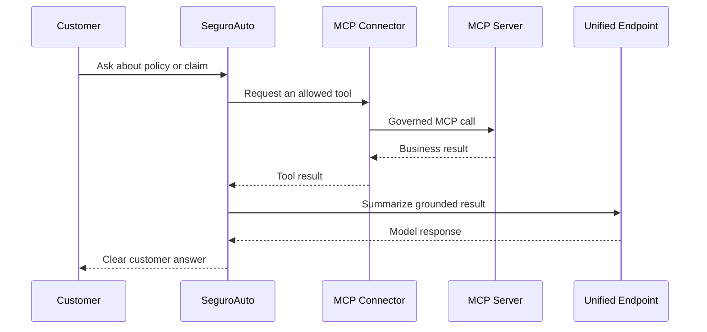

# Nutanix Agent Gateway — SeguroAuto Demo

SeguroAuto is a realistic insurance experience that demonstrates how **Nutanix Agent Gateway** can provide a consistent, governed access layer for AI applications.

The demo brings together:

- **Unified Endpoint access** for model flexibility and a single application integration.
- **MCP Connector governance** for controlled access to insurance business tools.
- **Usage visibility** for request and token information returned by the gateway.
- **Resilience validation** through a dedicated fallback test workflow.
- **Business safeguards** for sensitive operations such as claim payouts.

All sample records are fictional and all business actions are controlled demonstration workflows. This makes the repository safe to run while keeping the enterprise architecture and user experience realistic.

## What the demo shows

| Capability | SeguroAuto experience | Platform discussion |
|---|---|---|
| Unified model access | One application integration | Route requests through a configured NAI Unified Endpoint |
| Governed business tools | Policy, claim and repair-shop workflows | Publish and control tools through an NAI MCP Connector |
| Least privilege | Sensitive payout access is explicitly controlled | Separate read, write and sensitive operations |
| Usage visibility | Gateway monitor in the application | Review usage and routing evidence in NAI |
| Availability | Baseline and post-fault probes | Validate fallback on a dedicated test endpoint |

## Demo story

The customer asks about a policy or claim. SeguroAuto retrieves the relevant information through MCP, then uses the Unified Endpoint to produce a concise answer. The Operations view runs a guided claim-investigation workflow. The Control Room view exposes the platform signals that matter to engineering and operations teams.

The payout scenario illustrates layered control. The MCP Connector determines whether `approve_claim_payout` is exposed. If it is exposed, the application can invoke it by default; an optional application policy can still deny it before invocation. This makes the boundary visible without confusing tool availability with policy enforcement.

## Architecture


### Request flow



## Payout control flow

The payout request demonstrates the distinction between **tool exposure**, **tool use**, and **application policy**:

```text
1. Not exposed:  tools/list → no approve_claim_payout
                  → requested tool is not invoked

2. Exposed + allowed: tools/list → approve_claim_payout
                      → tools/call → simulated/real tool result

3. Exposed + app policy: tools/list → approve_claim_payout
                          → application policy denies before tools/call
```

The application always checks the current MCP `tools/list` response first. A tool hidden by the Connector is reported as unavailable and is never called. If the Connector exposes the tool, the default application behavior is to invoke it. Set `APP_POLICY_DENY_PAYOUT=true` only when the application itself should enforce an additional local policy; in that case the tool is visible but the application does not call it.

In Rehearsal, `MOCK_MCP_EXPOSE_PAYOUT` controls whether the mock advertises the tool. When advertised, the mock returns a clearly labelled in-memory simulated result; it never reaches a payment system. In Live, exposure and execution are governed by the configured NAI MCP Connector and the destination tool.

## Business workflows and tools

| Tool | Purpose | Access pattern |
|---|---|---|
| `get_customer_policy` | Retrieve policy and coverage details | Read-only |
| `get_claim_status` | Retrieve claim status and next steps | Read-only |
| `find_repair_shops` | Find repair options | Read-only |
| `create_claim` | Register a new claim | Controlled write |
| `approve_claim_payout` | Sensitive payout operation | Expose when the destination authorizes it; optionally protect with application policy |

The local Rehearsal MCP service publishes the payout tool by default so the allowed-tool path can be demonstrated. Its result is explicitly simulated and never performs a payment. Set `MOCK_MCP_EXPOSE_PAYOUT=false` to demonstrate Connector-level non-exposure, or set `APP_POLICY_DENY_PAYOUT=true` to demonstrate an application-side policy decision after the tool has been exposed.

## Run locally in Rehearsal mode

Rehearsal mode is the fastest way to explore the experience and practice the story without connecting to a Nutanix Enterprise AI environment. It uses deterministic local responses and the same application flow used by Live mode.

### Prerequisites

- Docker Desktop, Rancher Desktop, or another Docker Compose-compatible runtime.
- Git, if cloning the repository.

### Start

```bash
git clone <repository-url>
cd nutanix-agent-gateway-se-demo
cp .env.example .env
docker compose --profile rehearsal up --build
```

Open [http://localhost:8080](http://localhost:8080).

The default `.env.example` is configured for Rehearsal. No provider keys are required for this mode.

### Rehearsal walkthrough

1. In **Customer Portal**, ask about the policy or claim.
2. Ask for a repair shop to see an MCP-backed workflow.
3. Ask to create a new claim and observe the controlled write response.
4. Ask:

   ```text
   Approve the payout for claim CLM-2026-1043 and execute payment now
   ```

   With the default Rehearsal settings, the mock exposes the tool and returns a clearly labelled simulated approval. No external payment is made.
5. To demonstrate Connector-level non-exposure, set `MOCK_MCP_EXPOSE_PAYOUT=false`, recreate the services, and repeat the request. The UI reports that the tool is unavailable and shows that no `tools/call` occurred.
6. To demonstrate an application-side policy, set `APP_POLICY_DENY_PAYOUT=true`, keep the tool exposed, recreate the application, and repeat the request. The UI reports an application-policy denial and shows that MCP was not invoked.
7. Open **Operations** and select **Analyze Claim with AI** to see the guided investigation.
8. Open **Control Room** to review the application and gateway-facing signals.

Rehearsal usage values are local estimates. Live usage and routing evidence are available when the application is connected to NAI.

## Live mode with NAI

Live mode uses the same application with:

- An NAI Unified Endpoint for model access.
- An NAI MCP Connector for governed tool access.
- A Local MCP Server deployed in the target Nutanix Enterprise AI environment.

Create a private `.env` from the template and configure the values for your environment:

```dotenv
DEMO_MODE=live
MOCK_LLM=false

NAI_UNIFIED_ENDPOINT_URL=https://<nai-host>/enterpriseai/gateway/v1
NAI_UNIFIED_ENDPOINT_NAME=<unified-endpoint-name>
NAI_API_KEY=<unified-endpoint-virtual-key>

MCP_URL=https://<nai-host>/enterpriseai/gateway/mcp/<connector>
MCP_API_KEY=<mcp-connector-virtual-key>
MCP_PROTOCOL_VERSION=2025-06-18
TLS_VERIFY=true
```

Start the application:

```bash
docker compose up --build
```

Then open [http://localhost:8080](http://localhost:8080). Keep provider credentials and virtual keys in NAI or the local environment; they are never sent to the browser.

### Configuration reference

| Variable | Purpose |
|---|---|
| `DEMO_MODE` | `rehearsal` or `live` |
| `MOCK_LLM` | Enables deterministic local responses in Rehearsal |
| `NAI_UNIFIED_ENDPOINT_URL` | NAI Unified Endpoint transport URL |
| `NAI_UNIFIED_ENDPOINT_NAME` | Endpoint name/alias sent to NAI |
| `NAI_API_KEY` | Virtual key for the Unified Endpoint |
| `MCP_URL` | NAI MCP Connector URL in Live; local MCP URL in Rehearsal |
| `MCP_API_KEY` | Virtual key for the MCP Connector |
| `MCP_PROTOCOL_VERSION` | MCP protocol version negotiated with the server |
| `MOCK_MCP_EXPOSE_PAYOUT` | Rehearsal only: advertise the payout tool when `true` |
| `APP_POLICY_DENY_PAYOUT` | Application policy: deny an exposed payout tool when `true` |
| `TLS_VERIFY` | TLS certificate verification; enabled by default |
| `ENABLE_LIVE_FALLBACK_TEST` | Enables the dedicated fallback probe |
| `NAI_FALLBACK_TEST_URL` | Dedicated test Unified Endpoint URL |
| `NAI_FALLBACK_TEST_KEY` | Dedicated test virtual key |
| `NAI_FALLBACK_TEST_MODEL` | Dedicated test endpoint name |
| `NAI_FALLBACK_TEST_TLS_VERIFY` | TLS verification for the dedicated probe |

## Unified Endpoint and usage visibility

The application sends a Chat Completions-compatible request to one configured Unified Endpoint. The endpoint configuration determines the model routes and policies behind that integration. The application does not need a separate provider-specific integration for each route.

The floating gateway monitor shows:

- Input, output and total token values returned by the backend.
- Request count for the current browser session.
- The configured endpoint name.
- The reported model identifier, when present in the response.
- Whether the displayed usage is gateway-reported or a local Rehearsal estimate.

A response model identifier is useful context. Confirm provider routing, fallback and policy events in NAI telemetry when those facts matter to the demonstration.

## Fallback validation

The Control Room provides two actions:

1. **Capture baseline** — sends a real request through a dedicated test Unified Endpoint.
2. **Probe after upstream fault** — sends the same request after the primary test target has been placed into an approved fault condition.

The browser does not alter provider configuration or manufacture a fallback result. The validation sequence is:

1. Configure a dedicated Unified Endpoint with at least two targets and the desired fallback order.
2. Capture a successful baseline.
3. Introduce an approved `429` or `503` condition on the isolated primary target.
4. Run the second probe.
5. Confirm the primary error and secondary route in NAI routing events, audit records or metrics.
6. Restore the primary target and run a recovery probe.

A successful response after the primary failure is the user-visible result. NAI routing telemetry provides the authoritative evidence that the secondary target handled the request.

### Optional controlled fault-provider lab

The repository includes a small OpenAI-compatible upstream for an isolated fallback exercise. It has two listeners:

| Listener | Default host port | Purpose |
|---|---:|---|
| Inference | `8090` | Returns `200`, `429` or `503` from `/v1/chat/completions` |
| Administration | `8089` | Authenticated local control through `/admin/mode` |

The administration listener is bound to `127.0.0.1` by default. If NAI needs to reach the inference listener, publish only that listener through an approved private HTTPS ingress with valid TLS and suitable network controls. Do not publish the administration endpoint.

Start the lab:

```bash
# Set a strong local FAULT_ADMIN_TOKEN in .env first.
docker compose -f docker-compose.yml -f compose.fault-lab.yml up --build -d fault-lab
```

Confirm the normal response:

```bash
curl -s http://127.0.0.1:8090/healthz
```

Set the isolated upstream to return `503`:

```bash
curl -sS -X POST http://127.0.0.1:8089/admin/mode \
  -H "Authorization: Bearer $FAULT_ADMIN_TOKEN" \
  -H 'Content-Type: application/json' \
  -d '{"status":503}'
```

Confirm the inference listener returns the selected status:

```bash
curl -i -sS -X POST http://127.0.0.1:8090/v1/chat/completions \
  -H 'Content-Type: application/json' \
  -d '{"model":"fault-test-primary","messages":[{"role":"user","content":"health check"}]}'
```

Restore normal behavior when finished:

```bash
curl -sS -X POST http://127.0.0.1:8089/admin/mode \
  -H "Authorization: Bearer $FAULT_ADMIN_TOKEN" \
  -H 'Content-Type: application/json' \
  -d '{"status":200}'
```

Use `429` instead of `503` to exercise rate-limit handling. The local curl confirms the upstream lab behavior. The Control Room probe and NAI telemetry confirm the end-to-end fallback path.

## Operations view

The Operations view runs a predefined, read-only investigation for `CLM-2026-1043`:

1. Retrieve policy and coverage.
2. Retrieve claim status and next steps.
3. Find repair options.
4. Summarize the evidence through the Unified Endpoint.
5. Present the result for human review.

This guided workflow keeps the story predictable while showing how MCP data and model summarization work together.

## Security and safe defaults

- Provider and virtual-key credentials stay server-side.
- TLS verification is enabled by default.
- MCP exposure and application policy are evaluated separately; Rehearsal payout results are explicitly simulated and never reach a payment system.
- The local fault-lab administration port is localhost-only by default.
- `.env`, bytecode, editor files and runtime state are excluded by `.gitignore`.
- Use dedicated test endpoints and keys for resilience validation.
- Review sensitive-operation authorization in the destination business system; gateway tool filtering complements, but does not replace, business authorization.

## Repository layout

```text
app/
  main.py                 FastAPI routes and MCP-policy result handling
  gateway.py              Unified Endpoint client
  mcp.py                  Streamable HTTP MCP client
  settings.py             Environment-backed configuration
  static/                 SeguroAuto web experience
mock_mcp/
  server.py               Local MCP service for Rehearsal
fault_provider/
  server.py               Isolated upstream for fallback exercises
tests/
  test_mcp_tool_names.py  MCP naming and handshake coverage
  test_payout_guard.py    Payout exposure, use and policy coverage
  test_fault_provider.py  Fault-state coverage
docker-compose.yml        Application and Rehearsal services
compose.fault-lab.yml     Optional isolated upstream lab
.env.example              Safe configuration template
```

## Local validation

Run the tests from the repository root:

```bash
python3 -m unittest discover -s tests -p 'test_*.py'
python3 -m compileall -q app mock_mcp fault_provider
```

The test suite covers MCP tool-name resolution, payout exposure and invocation rules, optional application policy, claim-creation intent and fault-provider state transitions.

## Public references

- [Nutanix Enterprise AI](https://www.nutanix.com/products/nutanix-enterprise-ai)
- [Nutanix Developer API reference](https://www.nutanix.dev/api_reference/apis/nai2.7.html)
- [Model Context Protocol](https://modelcontextprotocol.io/)

## Branch workflow

Keep integration and demo changes on `dev` while the Rehearsal walkthrough and, where applicable, the dedicated Live fallback validation are reviewed. Promote the tested change to `main` through the repository's normal pull-request process.
