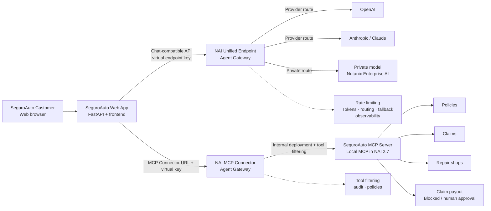
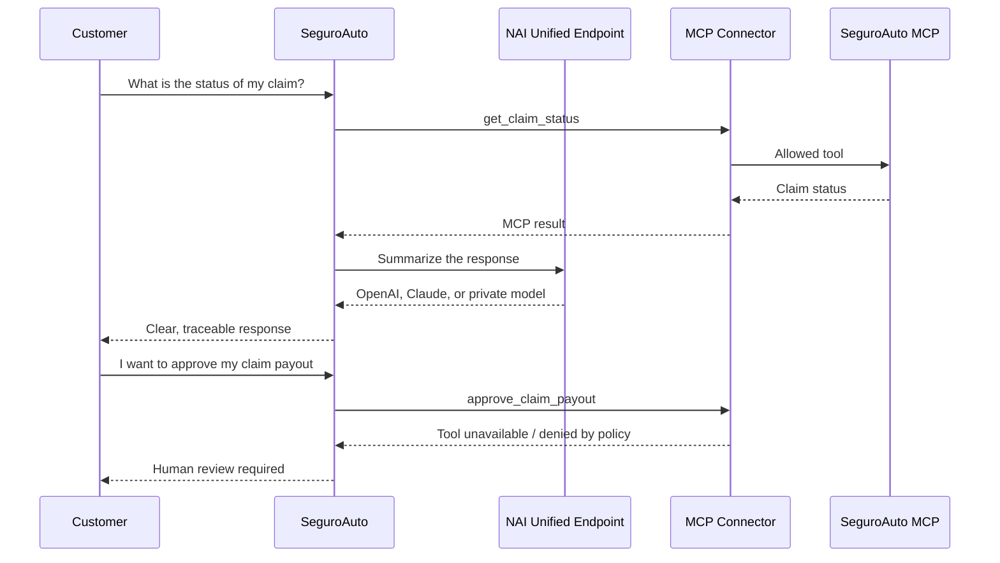

# Nutanix Agent Gateway — SeguroAuto Insurance AI Demo

## Overview

SeguroAuto is an insurance web application (not real)  built to demonstrate, through a realistic business scenario, how **Nutanix Agent Gateway** helps govern AI model access, token consumption, MCP tools, and sensitive business operations.

The demo also shows how Agent Gateway simplifies the work of **Forward Deployed Engineering and Development teams** through a **Unified Endpoint** that abstracts access to public and private AI models. These can include models from OpenAI, Mistral, Google Gemini, Anthropic, and Azure, alongside private models deployed on **Nutanix Enterprise AI (NAI)**.

Teams can adjust model routing, access policies, high availability, and fallback configurations without rewriting application integrations or changing API schemas, provided the selected models support the endpoint's interface and required features.

For end users, SeguroAuto supports everyday insurance workflows such as checking a policy, reviewing a claim, and finding a repair shop. For **Systems Engineers**, the app offers technical views that reveal how requests flow through the Unified Endpoint and how MCP Connectors provide governed access to business tools.

> **Demo environment:** SeguroAuto uses syntetic data and simulated business operations.

## Demo Objectives

The demo addresses five questions organizations face as they deploy AI applications and agents. Each connects to stakeholders who may own or influence the problem.

### 1. Model Access and Flexibility

**Personas** — CTO, AI Architect, Development Lead, AI Platform Engineer

How can we use OpenAI, Claude, and private AI models from our applications without integrating and maintaining every provider separately?

### 2. Token Consumption and Cost Control

**Personas** — FinOps, AI Platform Owner, IT Operations

How can we set token consumption limits and prevent an AI application or agent from creating unexpected costs?

### 3. Availability and Resilience

**Personas** — Platform Engineering, SRE, Infrastructure Architect

What happens if an AI provider is overloaded, reaches its limits, or becomes unavailable? How do we keep the application running without changing its code?

### 4. Security and Tool Access

**Personas** — CISO, Security Architect, AI Architect, Application Owner

How can an AI agent retrieve enterprise information and execute business operations without receiving excessive privileges?

### 5. Visibility, Traceability, and Governance

**Personas** — IT Operations, Security Operations, Compliance, AI Platform Owner

How can we identify which user or application initiated a request, which model handled it, which tools were invoked, and which operations were performed?

**What the demo demonstrates:** Nutanix Agent Gateway combines a model-facing **Unified Endpoint** with governed access to tools through **Model Context Protocol (MCP)**. The goal is to show how teams can bring AI applications into production while maintaining control over model access, usage, availability, and interactions with enterprise systems.

## Insurance Workflows and MCP Tools

The demo uses a dedicated MCP server exposing five tools that represent common insurance operations.

| Tool | Description | Demonstration focus |
|---|---|---|
| `get_customer_policy` | Retrieve a customer's policy details | Read-only access |
| `get_claim_status` | Check the status of an insurance claim | Read-only access |
| `find_repair_shops` | Find repair shops | Tool invocation and results |
| `create_claim` | Create a new insurance claim | Audited write operation |
| `approve_claim_payout` | Approve an insurance claim payout | Restricted sensitive operation |

This makes the distinction between reading data and taking actions concrete. Checking a claim does not require the same permissions as approving a payout. **Gateway tool filtering is not a substitute for business-level authorization**; any real payout workflow must enforce authorization and, where applicable, human approval in the destination system.

## Deployment Modes

| Mode | AI responses | MCP tools | Intended use |
|---|---|---|---|
| **Live** | NAI Unified Endpoint using configured providers | Local MCP Server deployed inside NAI 2.7, accessed through the NAI MCP Connector | Customer and partner demonstrations with real platform controls |
| **Rehearsal** | Deterministic mock responses | Local mock MCP server started by Docker Compose | Development, testing, and practicing without hPOC access |

In **Live** mode, the application connects to the **NAI MCP Connector**, not a mock server on the presenter's laptop. In **Rehearsal**, Docker Compose provides a self-contained local environment; its token estimates, model responses, and controls must not be presented as measurements or enforcement by NAI.

## How to Position the Demo with Customers

The presentation should follow the customer's challenge, not necessarily every available demo feature.

| Stakeholder | Recommended focus |
|---|---|
| **CTO / AI Architect** | Provider independence, hybrid architectures, unified model access |
| **Development Lead / FDE** | Simpler integrations, fewer code changes, easier model access |
| **Platform Engineering / SRE** | Availability, fallback, resilience, consumption control |
| **FinOps / AI Platform Owner** | Token limits, usage policies, cost control |
| **CISO / Security Architect** | MCP tool restrictions, least privilege, sensitive operations |
| **IT Operations / Compliance** | Auditability and visibility into AI interactions |

Start with the end-user insurance experience, then switch to the technical views to connect the observed behavior to Unified Endpoint routing, token usage, and MCP tool access. Use `approve_claim_payout` as a discussion point for authorization boundaries rather than implying that a model can approve financial transfers on its own.

## Architecture



### Simplified Flow



## Repository Components

```text
nutanix-agent-gateway-se-demo/
├── app/
│   ├── main.py                 FastAPI endpoints and business logic
│   ├── gateway.py              OpenAI-compatible client for NAI
│   ├── mcp.py                  MCP JSON-RPC client
│   ├── settings.py             Environment-based configuration
│   └── static/
│       ├── index.html          SeguroAuto portal and Control Room
│       ├── styles.css          Responsive UI styling
│       └── app.js              Interactions, chat, and token monitor
├── mock_mcp/
│   └── server.py               Mock MCP server for policies and claims
├── docker-compose.yml          Starts web app + mock MCP for local rehearsal
├── Dockerfile                  Reproducible container image
├── requirements.txt            Python dependencies
├── .env.example                Configuration template without secrets
└── README.md                   This guide
```

## Installation on macOS or Windows

### Prerequisites

- Docker Desktop.
- Network access to the shared hPOC environment for Live mode.
- Git (optional if cloning the project from GitHub).

### Clone the Repository

```bash
git clone https://github.com/<ORG_OR_USER>/nutanix-agent-gateway-se-demo.git
cd nutanix-agent-gateway-se-demo
```

### Create the Configuration File

On macOS, Linux, or Git Bash:

```bash
cp .env.example .env
```

On Windows PowerShell:

```powershell
Copy-Item .env.example .env
```

### Run the Application

```bash
# Live: NAI MCP Connector and Unified Endpoint
# Requires a .env file configured with NAI URLs and virtual keys.
docker compose up --build demo
```

Open:

```text
http://localhost:8080
```

### Rehearsal Without NAI

In `.env`:

```dotenv
DEMO_MODE=rehearsal
MOCK_LLM=true
MCP_URL=http://mcp-mock:8001/mcp
MCP_API_KEY=
```

Start the mock service using its compose profile:

```bash
docker compose --profile rehearsal up --build
```

In this mode:

- The mock MCP server runs locally within docker compose.
- Model responses are deterministic.
- The token monitor shows a local estimate.
- Real NAI rate limiting is not tested.
- MCP deployment and governance in NAI are not tested.

This mode is only for demo preparation or development without access to the hPOC environment. The Live demo must use the Local MCP Server deployed inside NAI 2.7 or newer versions.

### Live Mode

In `.env`:

```dotenv
DEMO_MODE=live
MOCK_LLM=false
NAI_UNIFIED_ENDPOINT_URL=https://<nai-host>/enterpriseai/gateway/v1
NAI_API_KEY=<virtual-unified-endpoint-key>
NAI_MODEL_OPENAI=<openai-model-alias>
NAI_MODEL_ANTHROPIC=<claude-model-alias>
NAI_MODEL_PRIVATE=<private-nai-model-alias>
```

For MCP governed by NAI:

```dotenv
MCP_URL=https://<nai-host>/enterpriseai/gateway/mcp/<connector>
MCP_API_KEY=<virtual-mcp-key>
```

## Environment Variables

| Variable | Required | Description |
|---|---|---|
| `NAI_UNIFIED_ENDPOINT_URL` | Live | Unified Endpoint URL |
| `NAI_API_KEY` | Live | Endpoint virtual key |
| `NAI_MODEL_OPENAI` | Live | OpenAI alias configured in NAI |
| `NAI_MODEL_ANTHROPIC` | Live | Claude alias configured in NAI |
| `NAI_MODEL_PRIVATE` | Live | Private-model alias |
| `MCP_URL` | Always | NAI MCP Connector URL in Live; `http://mcp-mock:8001/mcp` only for Rehearsal |
| `MCP_API_KEY` | Gateway MCP | MCP Connector virtual key |
| `MOCK_LLM` | No | Set to `true` for local Rehearsal |
| `APP_PORT` | No | Local application port |

MCP tool names can also be customized using `MCP_POLICY_TOOL`, `MCP_CLAIM_TOOL`, `MCP_REPAIR_TOOL`, `MCP_CREATE_CLAIM_TOOL`, and `MCP_BLOCKED_TOOL`.

## What the Unified Endpoint Does

The application does not need to know whether OpenAI, Claude, or a private model generates the response. It calls a single Chat Completions-compatible API:

```text
POST {NAI_UNIFIED_ENDPOINT_URL}/chat/completions
Authorization: Bearer {NAI_API_KEY}
```

The model name sent by the application corresponds to an alias configured in NAI. Only the alias or virtual key needs to change; the agent integration code remains the same.

The Unified Endpoint can centralize:

- Provider credentials.
- Routing across external and private endpoints.
- Fallback when an endpoint fails or reaches a limit.
- Weighted load balancing.
- Global and per-API-key rate limiting.
- Observability for tokens, errors, and usage.

## Token Monitor

The `UNIFIED ENDPOINT` monitor appears in the bottom-right corner of the application.

It displays:

- Input tokens.
- Output tokens.
- Cumulative total tokens.
- Number of requests made.
- Current model or alias.
- Whether the data comes from NAI or is a local estimate.

In Live mode, the backend normalizes the `usage` object returned by the Unified Endpoint:

```json
{
  "prompt_tokens": 120,
  "completion_tokens": 85,
  "total_tokens": 205
}
```

In rehearsal mode, the monitor displays a clearly labeled local estimate. This is useful for practicing the demo without real credentials, but must not be presented as token usage measured by NAI.

## DEV and PROD Environments

To demonstrate rate limiting, we use two Gateway configurations rather than two versions of the application.

| Aspect | DEV | PROD |
|---|---|---|
| Unified Endpoint | `seguroauto-dev` | `seguroauto-prod` |
| API key | Development virtual key | Production virtual key |
| Providers | OpenAI, Claude, and private | Approved providers only |
| Rate limiting | Intentionally low to trigger the limit | Business-defined budget |
| MCP | Test tools | Minimal, audited allowlist |
| Claim payouts | Blocked | Blocked or subject to human approval |
| Fallback | Visible during the demo | Configured for service continuity |
| Data | Fictional | Data approved for the environment |

The application itself must be identical in both environments. Only the following configuration changes:

```dotenv
NAI_UNIFIED_ENDPOINT_URL=...
NAI_API_KEY=...
MCP_URL=...
MCP_API_KEY=...
```

## NAI Setup

Exact labels may vary depending on the version and Hpoc environment, but the conceptual setup sequence is as follows.

### 1. Create Providers

In **Agent Gateway > Providers**:

- Create the OpenAI provider.
- Store the OpenAI API key in the NAI vault.
- Create the Anthropic provider.
- Store the Claude API key in the NAI vault.
- Register the private Nutanix Enterprise AI endpoint.

OpenAI and Anthropic API keys must never reach the browser or be stored in the repository.

### 2. Create Unified Endpoints

Create two endpoints:

```text
seguroauto-dev
seguroauto-prod
```

Each endpoint should include the aliases you want to demonstrate:

```text
openai-seguroauto
claude-seguroauto
private-seguroauto
```

Configure the following as appropriate for each environment:

- Primary provider.
- Fallback.
- Weighted load balancing.
- Token limits.
- Virtual API keys.

### 3. Create Virtual API Keys

Create a different key for each environment. For more granular attribution, consider one key per application or agent.

For example:

```text
seguroauto-dev-agent
seguroauto-prod-agent
```

The application only knows the NAI virtual key. It does not have access to OpenAI, Claude, or private-model provider credentials.

### 4. Configure Rate Limiting

Configure two levels of limits:

- **Global Unified Endpoint limit** — Protects the entire endpoint, the provider contract, or cluster capacity.
- **Granular per-API-key limit** — Prevents one application, user, or agent from consuming the entire budget.

For the demo:

1. Set an intentionally low limit in DEV.
2. Run several queries from SeguroAuto.
3. Show the token counter increasing.
4. Trigger the limit.
5. Show the response returned by NAI and the corresponding metric.
6. Switch to PROD and repeat with a different policy.

Do not simulate rate limiting in the frontend. The goal is to demonstrate an actual rate-limit response from NAI.

### 5. Deploy the Local MCP Server in NAI 2.7

The intended deployment workflow is to publish the mock server image to a registry accessible by the cluster, then deploy it using **Deploy Local MCP Server** in NAI.

#### Publish the Image to GHCR

From the repository root:

```bash
docker login ghcr.io
docker build -f mock_mcp/Dockerfile \
  -t ghcr.io/<ORG_OR_USER>/seguroauto-mcp:mcp-v0.2.0 .
docker push ghcr.io/<ORG_OR_USER>/seguroauto-mcp:mcp-v0.2.0
```

Alternatively, create and push the tag to trigger the included workflow:

```bash
git tag mcp-v0.2.0
git push origin mcp-v0.2.0
```

If the GHCR package is private, create an **Image Registry Credential** in NAI for `ghcr.io` using a token with package-read permission. If the Hpoc cannot access GHCR, use the approved internal registry with the corresponding image name and tag.

#### Create the Local MCP Server in NAI

In NAI 2.7:

1. Add or select the registry credential.
2. Go to **MCP Servers**.
3. Select **Deploy Local MCP Server**.
4. Use this image:

   ```text
   ghcr.io/<ORG_OR_USER>/seguroauto-mcp:mcp-v0.2.0
   ```

5. Configure MCP port `8001` and the MCP protocol required by the hPOC.
6. Deploy and wait until the server is `Ready`.
7. Create a **SeguroAuto MCP Connector** pointing to the local server.
8. Create a dedicated key for that Connector.

The server exposes the following tools:

| Tool | Purpose | Recommended Policy |
|---|---|---|
| `get_customer_policy` | Retrieve policy | Exposed, read-only |
| `get_claim_status` | Check claim | Exposed, read-only |
| `find_repair_shops` | Find repair shop | Exposed |
| `create_claim` | Create claim | Exposed with auditing |
| `approve_claim_payout` | Approve payout | Do not expose, or require human approval |

Apply tool filtering in the Connector and expose only the tools required by the SeguroAuto agent. Keep `approve_claim_payout` off the allowlist to demonstrate that the model can understand a payout request while the agent is not granted the ability to execute it.

### 6. Configure Auditing

During the demo, show:

- Which virtual key initiated the request.
- Which model generated the response.
- How many tokens were used.
- Which MCP tool was invoked.
- Which tool was denied.
- Which user or application initiated the operation.

## Local MCP Server Inside NAI 2.7

This demo uses MCP local deployment within NAI as its primary scenario:

```text
SeguroAuto on your laptop
         ↓ HTTPS/API
NAI Unified Endpoint              NAI MCP Connector
         ↓                                  ↓
OpenAI · Claude · Private NAI      Local MCP Server in NAI 2.7
                                            ↓
                                  Policies · claims · repair shops
```

In Live mode, the application does not call `mcp-mock` directly, does not need your laptop's IP address, and does not require Cloudflare Tunnel. The MCP Server runs as a workload managed by NAI, while the Connector provides identity, tool filtering, and auditing.

Docker compose retains `mcp-mock` for local rehearsal:

```text
SeguroAuto app → http://mcp-mock:8001/mcp
```

To switch to Live, change only the Connector configuration:

```dotenv
MCP_URL=https://<nai-host>/enterpriseai/gateway/mcp/<connector>
MCP_API_KEY=<virtual-mcp-key>
```

The same application and code work in both cases. What changes is the MCP entry point and the policies applied by NAI—not SeguroAuto's business logic.

## Complete Demo Walkthrough

### 1.- Customer Experience

1. Open the SeguroAuto portal.
2. Show the active policy.
3. Ask:

   ```text
   What coverage and deductible does my policy include?
   ```

4. Ask:

   ```text
   What is the status of my claim?
   ```

5. Show that the application only knows the NAI endpoint and its associated API key. It always uses an OpenAI-compatible API schema, regardless of which models are part of the Unified Endpoint. Depending on the routing configuration, requests may be sent to different model endpoints, including when weighted routing is enabled.

### 2.- MCP and Business Operations

1. Select **Find a Repair Shop**.
2. Show `find_repair_shops` in the audit trail.
3. Open the **Operations** view.
4. Run the full customer journey.
5. Explain how the agent combines policy, claim, and repair-shop information through MCP.

Suggested talking point:

> The application does not need a separate API integration for every business system. The agent is given governed tools, and the Gateway controls which ones it can access.

### 3.- Unauthorized Operation

1. Ask:

   ```text
   I want to approve the payout for my claim.
   ```

2. Show that the agent understands the request.
3. Show that `approve_claim_payout` cannot be executed.
4. Show the blocked-action record.
5. Confirm that no payment was made.

Suggested talking point:

> The model can understand the intent, but the Gateway policy—not the model—determines whether the tool is available. Business-level authorization remains the responsibility of the underlying system.

### 4.- Unified Endpoint

1. Run a query.
2. Show the model alias and token counter.
3. In NAI, open the Unified Endpoint and remove one of the configured models, such as OpenAI, Claude, or the local endpoint.
4. Repeat the same query without changing the application code.
5. Switch to Claude.
6. Explain that the user-facing application experience remains unchanged.

Suggested talking point:

> We changed the provider and the route, but we did not change the agent or the application.

### 5.- Rate Limiting

1. Open the DEV configuration in NAI.
2. Show the global limit and API-key-level limit.
3. Run several requests from SeguroAuto.
4. Watch the token monitor increase.
5. Reach the configured limit.
6. Show the rate-limit response.
7. Open the NAI metrics.
8. Switch to the PROD configuration.
9. Repeat and compare the behavior.

The goal is to show that consumption can be controlled before it becomes an unexpected cost.

### 6.- Fallback

1. Configure OpenAI as the primary route.
2. Configure Claude as the fallback.
3. Configure the private model as the final fallback.
4. Simulate a `429` or `503` response from the primary provider.
5. Repeat the query.
6. Show that the application continues working and that the route changes in NAI.

## Tailoring the Demo to Each Persona

### Infrastructure Manager

Emphasize:

- Service availability.
- Protection of private cluster capacity.
- Fallback when a provider fails.
- Weighted load balancing.
- Consumption control across GPUs and cloud providers.
- Separation of DEV and PROD.
- No exposure of master provider credentials.

Question to answer:

> How do I keep the application available while controlling where inference runs?

### Dev/Ops Manager

Emphasize:

- A stable API for the agent.
- No integration rewrite when switching models.
- Per-application or per-agent rate limiting.
- Virtual keys and traceability.
- MCP tool allowlists.
- Blocking sensitive actions.
- Audit evidence.

Question to answer:

> How do I make the agent useful without granting excessive permissions or an unlimited budget?

### Business Stakeholder

Emphasize:

- Faster resolution of customer queries.
- A consistent customer experience.
- Continuity when a provider fails.
- Cost control.
- Separation of automated recommendations from decisions requiring approval.

## Security

- Never commit `.env` to GitHub.
- Never expose OpenAI or Anthropic API keys in the frontend.
- Keep provider credentials in the NAI vault.
- Use separate virtual keys for each environment.
- Use a dedicated MCP virtual key, separate from the Unified Endpoint virtual key.
- Apply least privilege to MCP tools.
- In Live mode, do not connect the laptop's mock server to the hPOC; use the Local MCP Server deployed in NAI 2.7.
- Use only fictional data in the demo.
- Keep payout operations and sensitive data changes subject to human approval.

## Troubleshooting

### The Application Opens but Displays `CONFIGURATION ERROR`

In Live mode, check:

- `docker compose up --build demo` completed without errors.
- `NAI_UNIFIED_ENDPOINT_URL` and `NAI_API_KEY` are correct.
- `MCP_URL` contains the NAI MCP Connector URL.
- `MCP_API_KEY` belongs to that Connector.

In Rehearsal mode, check:

- You started with `docker compose --profile rehearsal up --build`.
- `mcp-mock` is healthy.
- `MCP_URL=http://mcp-mock:8001/mcp`.

### The Monitor Displays `Local Estimate`

The application is running with `MOCK_LLM=true` or is missing `NAI_API_KEY` and `NAI_UNIFIED_ENDPOINT_URL`. Switch to Live mode to display measured token usage.

### The Model Returns an Error

Check:

- The complete Unified Endpoint URL.
- A valid virtual key.
- The exact model alias.
- Connectivity from Docker Desktop to the hPOC.
- Provider configuration and credentials in NAI.

### MCP Does Not Respond from NAI

Check the **Local MCP Server** deployment in NAI 2.7:

- The container image is accessible from the configured registry.
- The Image Registry Credential has read permission.
- The workload is `Ready`.
- The configured MCP port is `8001`.
- The Connector points to the correct Local MCP Server.
- The virtual key used by the application belongs to the Connector.
- `MCP_URL` contains the Connector URL, not `http://mcp-mock:8001/mcp`.

`http://mcp-mock:8001/mcp` works only for local Rehearsal within Docker Desktop.

### The Rate Limit Is Not Triggered

When rehearsing rate limiting:

- Use a DEV virtual key.
- Temporarily configure a low limit in NAI.
- Generate multiple requests from the application.
- Check metrics and usage in NAI.
- Do not confuse the visual token counter with the rate limit: the former shows consumption; the latter enforces a policy.

## Included Local Validation

The locally tested workflow includes:

- Policy lookup.
- Claim status lookup.
- Repair-shop search.
- Simulated claim creation.
- Blocking `approve_claim_payout`.
- MCP tool discovery.
- Token-usage response.
- Visual token monitor.

## Reference Documentation

- [NAI AI Gateway — Unified Endpoints](https://docs.google.com/document/d/1o1HQC2rEka2uVbSzmsWtT__kL77m2iRkI27RFMYriHU)
- [Nutanix Enterprise AI — SE Field Demo Guide](https://docs.google.com/document/d/1iOFNW9OZK8-9yztoxK6yujg8tvmsOr76dw38x9Lz11I)
- [Nutanix AI Gateway — Internal Presentation](https://nutanixinc.sharepoint.com/sites/NFLCore/_layouts/15/Doc.aspx?sourcedoc=%7B6C921C1F-D155-4845-B7D8-C4403592D4D3%7D&file=Nutanix_AI%2BGateway.pptx&action=edit&mobileredirect=true&web=1)
