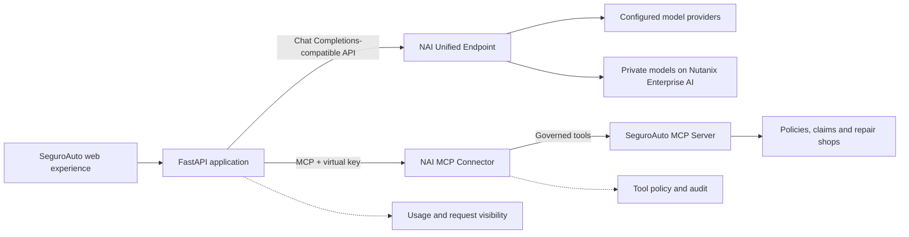
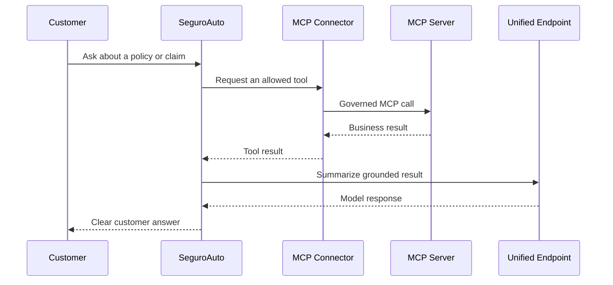

# Nutanix Agent Gateway Demo

SeguroAuto is a fictional online-insurance experience that demonstrates how Nutanix Agent Gateway can provide a consistent, governed access layer for AI applications.

The demo combines:

* A Unified Endpoint for model access, routing, load balancing and fallback.
* An MCP Connector for governed access to insurance business tools.
* A local MCP Server that can be deployed in a Nutanix Enterprise AI environment.
* Usage visibility for request and token information returned by the gateway.
* A controlled fallback-validation workflow.
* Layered controls for sensitive operations such as claim payouts.

All records are fictional. Rehearsal mode uses deterministic local services and never processes a real claim or payment.

## What the demo shows

| Capability | SeguroAuto experience | Platform discussion |
|---|---|---|
| Unified model access | One application integration | Route requests through one configured NAI Unified Endpoint |
| Governed business tools | Policy, claim and repair-shop workflows | Publish and control tools through an NAI MCP Connector |
| Least privilege | Separate read, write and sensitive operations | Control which tools are exposed to the application |
| Usage visibility | Gateway monitor in the application | Review usage and routing evidence in NAI |
| Availability | Baseline and post-fault probes | Validate fallback on a dedicated test endpoint |
| Safe operations | Payout exposure is explicit and configurable | Separate tool availability from application policy and business authorization |

## How different teams use the demo

SeguroAuto is designed as a shared reference point for customer-facing engineering, delivery and infrastructure teams. Each team can use the same scenario to focus on a different part of the enterprise AI operating model.

| Team | Primary perspective | What the demo helps demonstrate |
|---|---|---|
| **FDE / Solutions Engineering** | Translate a business workflow into a repeatable technical outcome | Connect an application to governed model and MCP services, validate customer requirements, compare deployment options and make the value of the platform visible in a realistic workflow |
| **DevOps / Platform Engineering** | Make the solution deployable, repeatable and supportable | Package the application and MCP server, manage environment-specific configuration, automate image publication with GitHub Actions, and reproduce controlled validation scenarios |
| **Infrastructure / Cloud / SRE** | Operate the platform with security, resilience and clear evidence | Validate TLS and network paths, Unified Endpoint routing and load balancing, fallback behavior, resource placement, observability and controlled fault testing |

The shared workflow is deliberately simple:

1. **FDE** defines the customer scenario, success criteria and required controls.
2. **DevOps** turns the scenario into a repeatable deployment and test workflow.
3. **Infrastructure and SRE** validate connectivity, resilience, security and operational evidence in NAI.
4. The teams review the same request, tool and routing signals to agree on the outcome and next action.

This makes the demo useful not only as a product walkthrough, but also as a starting point for discovery workshops, architecture reviews and operational handover.

## Architecture



## Request flow



## Payout control flow

The payout scenario demonstrates three independent states. The application checks the current `tools/list` response before attempting a tool call.

| State | Result |
|---|---|
| Tool not exposed by the MCP Connector | The application reports that the tool is unavailable and does not call it. |
| Tool exposed and application policy allows it | The application invokes the tool. In Rehearsal, the result is explicitly simulated and never reaches a payment system. |
| Tool exposed but `APP_POLICY_DENY_PAYOUT=true` | The application reports an application-policy denial and does not call the tool. |

In Live mode, exposure and execution are governed by the configured NAI MCP Connector and the destination system. Gateway tool filtering and application policy complement, but do not replace, business authorization and human approval in the destination system.

## Business tools

| Tool | Purpose | Access pattern |
|---|---|---|
| `get_customer_policy` | Retrieve policy and coverage details | Read-only |
| `get_claim_status` | Retrieve claim status and next steps | Read-only |
| `find_repair_shops` | Find repair options | Read-only |
| `create_claim` | Register a new claim | Controlled write |
| `approve_claim_payout` | Sensitive payout operation | Expose only when authorized; optionally protect with application policy |

The local Rehearsal MCP service can advertise the payout tool so that the allowed-tool path can be demonstrated safely. Its response is simulated and never performs a payment.

## Run locally in Rehearsal mode

Rehearsal mode is the fastest way to explore the experience without connecting to a Nutanix Enterprise AI environment.

### Prerequisites

* Docker Desktop, Rancher Desktop or another Docker Compose-compatible runtime.
* Git, if cloning the repository.
* Port `8080` available for the web application.

### Start

```bash
git clone https://github.com/jovalen/nutanix-agent-gateway-se-demo.git
cd nutanix-agent-gateway-se-demo
cp .env.example .env
```

For a local Rehearsal, set these values in `.env`:

```dotenv
DEMO_MODE=rehearsal
MOCK_LLM=true
MCP_URL=http://mcp-mock:8001/mcp
MCP_API_KEY=
TLS_VERIFY=true
MOCK_MCP_EXPOSE_PAYOUT=true
APP_POLICY_DENY_PAYOUT=false
```

Start the application and mock MCP service:

```bash
docker compose --profile rehearsal up --build
```

Open [http://localhost:8080](http://localhost:8080).

### Rehearsal walkthrough

* Ask about the customer policy or claim status.
* Ask for a repair shop to see an MCP-backed workflow.
* Ask to create a claim and observe the controlled write response.
* Ask:

  ```text
  Approve the payout for claim CLM-2026-1043 and execute payment now
  ```

* With `MOCK_MCP_EXPOSE_PAYOUT=true` and `APP_POLICY_DENY_PAYOUT=false`, the application invokes the exposed mock tool and shows a clearly labelled simulated result.
* Set `MOCK_MCP_EXPOSE_PAYOUT=false`, recreate the services and repeat the request to demonstrate Connector-level non-exposure.
* Set `APP_POLICY_DENY_PAYOUT=true` while keeping the tool exposed, recreate the application and repeat the request to demonstrate an application-side policy decision.
* Open Operations and select `Analyze Claim with AI` to see the guided investigation.
* Open Control Room to review application and gateway-facing signals.

Rehearsal token values are local estimates. They are not measurements from NAI.

To recreate services after changing `.env`:

```bash
docker compose --profile rehearsal down
docker compose --profile rehearsal up --build --force-recreate
```

## Run in Live mode with NAI

Live mode uses the same application with:

* An NAI Unified Endpoint for model access.
* An NAI MCP Connector for governed tool access.
* A Local MCP Server deployed in the target Nutanix Enterprise AI environment.

Create a private `.env` from the template and configure values for your environment:

```dotenv
DEMO_MODE=live
MOCK_LLM=false
NAI_UNIFIED_ENDPOINT_URL=https://<nai-host>/enterpriseai/gateway/v1
NAI_UNIFIED_ENDPOINT_NAME=<unified-endpoint-name>
NAI_API_KEY=<unified-endpoint-virtual-key>
MCP_URL=https://<nai-host>/enterpriseai/gateway/mcp/<connector>
MCP_API_KEY=<mcp-connector-virtual-key>
MCP_PROTOCOL_VERSION=2025-06-18
TLS_VERIFY=true
```

Start the application:

```bash
docker compose up --build demo
```

Open [http://localhost:8080](http://localhost:8080).

Provider credentials and virtual keys remain server-side. They are not sent to the browser.

## Configuration reference

| Variable | Purpose |
|---|---|
| `DEMO_MODE` | `rehearsal` or `live` |
| `MOCK_LLM` | Enables deterministic local responses in Rehearsal |
| `NAI_UNIFIED_ENDPOINT_URL` | NAI Unified Endpoint transport URL |
| `NAI_UNIFIED_ENDPOINT_NAME` | Endpoint name or alias sent to NAI |
| `NAI_API_KEY` | Virtual key for the Unified Endpoint |
| `MCP_URL` | NAI MCP Connector URL in Live; local MCP URL in Rehearsal |
| `MCP_API_KEY` | Virtual key for the MCP Connector |
| `MCP_PROTOCOL_VERSION` | MCP protocol version negotiated with the server |
| `TLS_VERIFY` | TLS certificate verification; keep enabled for normal use |
| `MOCK_MCP_EXPOSE_PAYOUT` | Rehearsal only: advertise `approve_claim_payout` when `true` |
| `APP_POLICY_DENY_PAYOUT` | Deny an exposed payout tool before invocation when `true` |
| `ENABLE_LIVE_FALLBACK_TEST` | Enables the dedicated fallback probe |
| `NAI_FALLBACK_TEST_URL` | Dedicated test Unified Endpoint URL |
| `NAI_FALLBACK_TEST_KEY` | Dedicated test virtual key |
| `NAI_FALLBACK_TEST_MODEL` | Dedicated test endpoint name |
| `NAI_FALLBACK_TEST_TLS_VERIFY` | TLS verification for the dedicated fallback probe |
| `FAULT_ADMIN_TOKEN` | Local administrative token for the optional fault lab; never commit it |

The MCP tool names can be customized with `MCP_POLICY_TOOL`, `MCP_CLAIM_TOOL`, `MCP_REPAIR_TOOL`, `MCP_CREATE_CLAIM_TOOL` and `MCP_BLOCKED_TOOL`.

## Unified Endpoint and usage visibility

The application sends a Chat Completions-compatible request to one configured Unified Endpoint. The endpoint configuration determines model routes, provider selection, load balancing and fallback behavior behind that integration.

The application does not need a separate provider-specific integration for each route. The floating Gateway monitor shows:

* Input, output and total token values returned by the backend.
* Request count for the current browser session.
* The configured endpoint name.
* The reported model identifier, when present in the response.
* Whether usage is reported by the gateway or is a local Rehearsal estimate.

A response model identifier is useful context, but it is not authoritative evidence of provider routing. Confirm routing, fallback and policy events in NAI telemetry when those facts matter to the demonstration.

## Publish the MCP image with GitHub Actions

The repository includes the workflow [`publish-mcp.yml`](.github/workflows/publish-mcp.yml). It builds `mock_mcp/Dockerfile` and publishes the image to GitHub Container Registry (GHCR).

The workflow runs:

* Manually through GitHub Actions using `workflow_dispatch`.
* Automatically when a tag matching `mcp-*` is pushed.

To publish a versioned image from a tag:

```bash
git tag mcp-v0.3.0
git push origin mcp-v0.3.0
```

The workflow publishes:

```text
ghcr.io/<repository-owner>/seguroauto-mcp:mcp-v0.3.0
ghcr.io/<repository-owner>/seguroauto-mcp:latest
```

The workflow uses GitHub's `GITHUB_TOKEN` with package-write permission; no provider API key is required for this build.

If the GHCR package is private, create an Image Registry Credential in NAI with package-read permission. If the target environment cannot reach GHCR, publish the same image to an approved internal registry and use that image reference when deploying the Local MCP Server.

### Manual image publication

If GitHub Actions is not used:

```bash
docker login ghcr.io
docker build -f mock_mcp/Dockerfile \\
  -t ghcr.io/<repository-owner>/seguroauto-mcp:mcp-v0.3.0 .
docker push ghcr.io/<repository-owner>/seguroauto-mcp:mcp-v0.3.0
```

### Deploy the Local MCP Server

In the target Nutanix Enterprise AI environment:

1. Add or select the registry credential.
2. Open MCP Servers.
3. Select Deploy Local MCP Server.
4. Use the published image, for example:

   ```text
   ghcr.io/<repository-owner>/seguroauto-mcp:mcp-v0.3.0
   ```

5. Configure MCP port `8001`.
6. Deploy and wait until the server is Ready.
7. Create an MCP Connector pointing to the Local MCP Server.
8. Create a dedicated virtual key for that Connector.
9. Set `MCP_URL` and `MCP_API_KEY` in the application's private `.env`.

The exact labels can vary by NAI release. Use the protocol and deployment settings supported by the target environment.

## Fallback validation

The Control Room provides two actions:

1. `Capture baseline` sends a real request through a dedicated test Unified Endpoint.
2. `Probe after upstream fault` sends the same request after the isolated primary target has been placed into an approved fault condition.

The browser does not change NAI provider configuration and does not manufacture a fallback result.

### Recommended sequence

1. Configure a dedicated Unified Endpoint with at least two targets and the desired fallback order.
2. Use a dedicated virtual key and avoid shared customer or demonstration traffic.
3. Capture a successful baseline.
4. Introduce an approved `429` or `503` condition on the isolated primary target.
5. Run the second probe.
6. Confirm the primary error and secondary route in NAI routing events, audit records or metrics.
7. Restore the primary target and run a recovery probe.

A successful response after a primary failure is the user-visible result. NAI routing telemetry is the authoritative evidence that the secondary target handled the request.

## Optional controlled fault-provider lab

The repository includes a small OpenAI-compatible upstream for an isolated fallback exercise. It can return normal responses, `429` or `503` from its inference listener.

The recommended lab topology is:

| Listener | Host port | Purpose |
|---|---:|---|
| Inference | `8090` | Returns `200`, `429` or `503` from `/v1/chat/completions` |
| Administration | `8089` | Authenticated local control through `/admin/mode` |

The administration listener must remain local-only. If NAI needs to reach the inference listener, publish only the inference route through an approved private HTTPS ingress with valid TLS and suitable network controls. Never publish `/admin/mode`.

Start the lab:

```bash
# Set a strong local FAULT_ADMIN_TOKEN in .env first.
docker compose -f docker-compose.yml -f compose.fault-lab.yml up --build -d fault-lab
```

Confirm normal behavior:

```bash
curl -s http://127.0.0.1:8090/healthz
```

Set the isolated upstream to return `503`:

```bash
curl -sS -X POST http://127.0.0.1:8089/admin/mode \\
  -H "Authorization: Bearer $FAULT_ADMIN_TOKEN" \\
  -H 'Content-Type: application/json' \\
  -d '{"status":503}'
```

Confirm the inference listener:

```bash
curl -i -sS -X POST http://127.0.0.1:8090/v1/chat/completions \\
  -H 'Content-Type: application/json' \\
  -d '{"model":"fault-test-primary","messages":[{"role":"user","content":"health check"}]}'
```

Restore normal behavior after the test:

```bash
curl -sS -X POST http://127.0.0.1:8089/admin/mode \\
  -H "Authorization: Bearer $FAULT_ADMIN_TOKEN" \\
  -H 'Content-Type: application/json' \\
  -d '{"status":200}'
```

Use `429` instead of `503` to exercise rate-limit handling. The local curl confirms the upstream lab behavior; the Control Room probe and NAI telemetry confirm the end-to-end fallback path.

## Operations view

The Operations view runs a predefined, controlled investigation for claim `CLM-2026-1043`:

* Retrieve policy and coverage.
* Retrieve claim status and next steps.
* Find repair options.
* Summarize the evidence through the Unified Endpoint.
* Present the result for human review.


## Repository layout

```text
nutanix-agent-gateway-se-demo/
├── app/
│   ├── main.py                 FastAPI routes and demo workflows
│   ├── gateway.py              Unified Endpoint client
│   ├── mcp.py                  Streamable HTTP MCP client
│   ├── settings.py             Environment-backed configuration
│   └── static/                 SeguroAuto web experience
├── mock_mcp/
│   ├── server.py               Local MCP service for Rehearsal
│   └── Dockerfile              MCP image definition
├── fault_provider/
│   ├── server.py               Isolated upstream for fallback exercises
│   └── Dockerfile              Fault-lab image definition
├── tests/                      Local validation
├── .github/workflows/
│   └── publish-mcp.yml         Builds and publishes the MCP image
├── docker-compose.yml          Application and Rehearsal services
├── compose.fault-lab.yml       Optional isolated upstream lab
├── .env.example                Configuration template without secrets
└── README.md                   This guide
```


## Public references

* [Nutanix Enterprise AI API reference](https://www.nutanix.dev/api_reference/apis/nai2.7.html)
* [Model Context Protocol](https://modelcontextprotocol.io/)
* [GitHub Actions documentation](https://docs.github.com/en/actions)
* [GitHub Container Registry documentation](https://docs.github.com/en/packages/working-with-a-github-packages-registry/working-with-the-container-registry)
