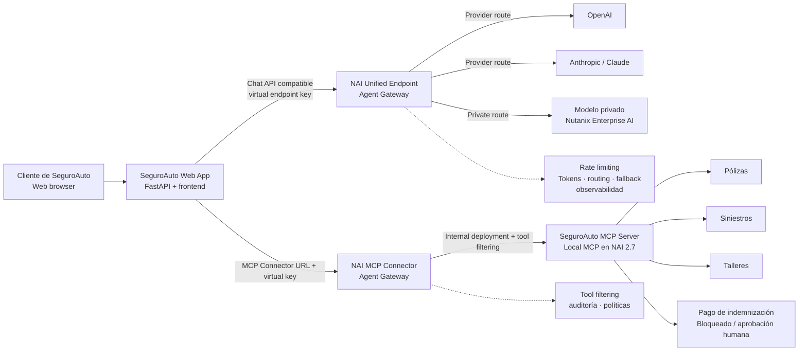
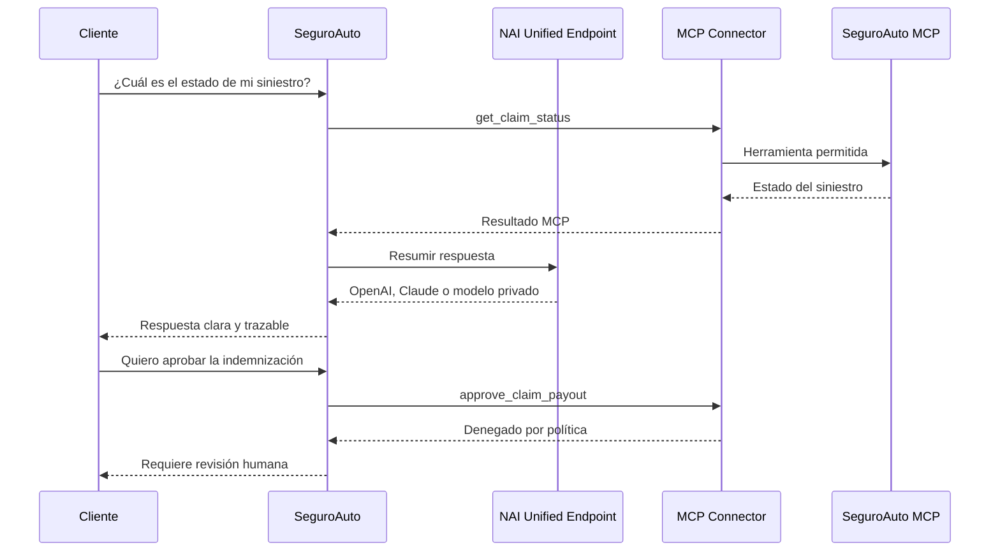

# Nutanix Agent Gateway SE Demo

Aplicación web de una aseguradora de auto para demostrar, con una experiencia de negocio real, cómo Nutanix Agent Gateway controla el acceso de una aplicación IA a modelos, tokens, herramientas MCP y operaciones sensibles.

El usuario final consulta su póliza, revisa un siniestro y busca un taller. El SE puede cambiar a la vista para enseñar qué ocurre por detrás cuando la aplicación utiliza un Unified Endpoint y un MCP Connector.

## Objetivo de la demo

La demo responde a cinco preguntas que los clientes desplegando agentes o aplicaciones de IA deben hacerse:

* ¿Cómo damos acceso a OpenAI, Claude y modelos privados sin integrar cada proveedor directamente en cada aplicación?
* ¿Cómo protegemos el presupuesto de tokens y evitamos que un agente se dispare en consumo?
* ¿Cómo mantenemos la aplicación operativa si un proveedor está saturado o no disponible?
* ¿Cómo permitimos que un agente consulte datos y use herramientas sin darle permisos de administrador?
* ¿Cómo puedo saber qué usuario, aplicación, modelo y herramienta generaron cada acción?


> En el escenario live de esta demo, el MCP no se ejecuta en el portátil: se publica como **Local MCP Server dentro de NAI 2.7** y la aplicación accede a él únicamente mediante el MCP Connector de NAI. Docker Compose conserva el mock local solo para rehearsal y desarrollo sin hPOC.

## Qué verá el usuario

La pantalla principal representa el portal de cliente de SeguroAuto (compañía ficticia ;-) ).

El usuario puede:

* Consultar las coberturas y la franquicia de su póliza.
* Consultar el estado de un siniestro.
* Buscar un taller concertado.
* Crear un nuevo parte.
* Preguntar por una indemnización.

La solicitud de indemnización es intencionadamente sensible. El agente puede explicar el proceso, pero `approve_claim_payout` queda bloqueada porque requiere revisión humana. No se ejecuta ningún pago.

## Arquitectura



### Flujo simplificado



## Componentes del repositorio

```text
nutanix-agent-gateway-se-demo/
├── app/
│   ├── main.py                 API FastAPI y flujo de negocio
│   ├── gateway.py              Cliente OpenAI-compatible para NAI
│   ├── mcp.py                  Cliente MCP JSON-RPC
│   ├── settings.py             Configuración desde variables de entorno
│   └── static/
│       ├── index.html          Portal SeguroAuto y Control Room
│       ├── styles.css          Diseño visual responsive
│       └── app.js               Interacción, chat y monitor de tokens
├── mock_mcp/
│   └── server.py               MCP ficticio de pólizas y siniestros
├── docker-compose.yml          Arranque de web + MCP mock para rehearsal local
├── Dockerfile                  Imagen reproducible
├── requirements.txt            Dependencias Python
├── .env.example                Plantilla sin secretos
└── README.md                   Esta guía
```

## Qué hace el Unified Endpoint

La aplicación no necesita saber si la respuesta la genera OpenAI, Claude o un modelo privado. El cliente llama a una única API compatible con Chat Completions:

```text
POST {NAI_UNIFIED_ENDPOINT_URL}/chat/completions
Authorization: Bearer {NAI_API_KEY}
```

El nombre del modelo enviado por la aplicación corresponde al alias configurado en NAI. La aplicación únicamente cambia el alias o la key; no cambia el código de integración del agente.

El Unified Endpoint puede centralizar:

* Credenciales de providers.
* Routing entre endpoints externos y privados.
* Fallback cuando un endpoint falla o alcanza un límite.
* Weighted load balancing.
* Rate limiting global y por API key.
* Observabilidad de tokens, errores y uso.

## Monitor de tokens

En la esquina inferior derecha de la aplicación aparece el monitor `UNIFIED ENDPOINT`.

Muestra:

* Tokens de entrada.
* Tokens de salida.
* Tokens totales acumulados.
* Número de peticiones realizadas.
* Modelo o alias actualmente utilizado.
* Si el dato proviene de NAI o es una estimación local.

En modo live, el backend normaliza el objeto `usage` devuelto por el Unified Endpoint:

```json
{
  "prompt_tokens": 120,
  "completion_tokens": 85,
  "total_tokens": 205
}
```

En modo rehearsal, el monitor muestra una estimación local y lo indica explícitamente. Esto permite ensayar la narrativa sin credenciales reales, pero no debe presentarse como consumo medido por NAI.

## Entornos DEV y PROD

La demostración debe utilizar dos configuraciones del Gateway, no dos versiones de la aplicación.

| Aspecto | DEV | PROD |
|---|---|---|
| Unified Endpoint | `seguroauto-dev` | `seguroauto-prod` |
| API key | Clave virtual de desarrollo | Clave virtual de producción |
| Providers | OpenAI, Claude y privado | Solo providers aprobados |
| Rate limiting | Intencionadamente bajo para provocar el límite | Presupuesto definido por negocio |
| MCP | Herramientas de prueba | Allowlist mínima y auditada |
| Indemnización | Bloqueada | Bloqueada o con aprobación humana |
| Fallback | Visible durante la demo | Configurado para continuidad |
| Datos | Ficticios | Datos aprobados para el entorno |

La aplicación debe ser idéntica en ambos casos. Solo cambian:

```dotenv
NAI_UNIFIED_ENDPOINT_URL=...
NAI_API_KEY=...
MCP_URL=...
MCP_API_KEY=...
```

## Preparación en NAI

Los nombres exactos pueden variar según la versión y el entorno hPOC, pero la secuencia conceptual es la siguiente.

### Registry recomendado para el MCP local

No se asume un registry interno concreto para el hPOC. Como el proyecto vive en GitHub, la opción más directa es GitHub Container Registry (GHCR):

```bash
docker build -f mock_mcp/Dockerfile \
  -t ghcr.io/jovalen/seguroauto-mcp:mcp-v0.2.0 .

docker push ghcr.io/jovalen/seguroauto-mcp:mcp-v0.2.0
```

En NAI 2.7: 

* Si la imagen GHCR es pública y el hPOC tiene salida a Internet, se puede desplegar sin credencial privada.
* Si la imagen GHCR es privada, añadir una Image Registry Credential con `ghcr.io`, usuario y token con permiso de lectura de paquetes.
* Si el hPOC es aislado, publicar la misma imagen en el registry interno aprobado.

El repositorio incluye `.github/workflows/publish-mcp.yml`, que publica la imagen en GHCR al crear un tag con el formato `mcp-*`.

La imagen usa el protocolo MCP `2025-06-18`, que es el protocolo soportado por la guía de despliegue de NAI 2.7.

### 1. Crear providers

En Agent Gateway > Providers:

* Crear el provider OpenAI.
* Registrar la API key de OpenAI en el vault de NAI.
* Crear el provider Anthropic.
* Registrar la API key de Claude en el vault de NAI.
* Registrar el endpoint privado de Nutanix Enterprise AI.

Las API keys de OpenAI y Anthropic no deben llegar al navegador ni guardarse en el repositorio.

### 2. Crear Unified Endpoints

Crear dos endpoints:

```text
seguroauto-dev
seguroauto-prod
```

Cada uno debe incluir los alias que se quieran demostrar:

```text
openai-seguroauto
claude-seguroauto
private-seguroauto
```

Configurar, según el objetivo del entorno:

* Provider principal.
* Fallback.
* Weighted load balancing.
* Límites de tokens.
* API keys virtuales.

### 3. Crear API keys virtuales

Crear una key diferente para cada entorno y, si se quiere mostrar atribución granular, una key por aplicación o agente.

Ejemplo:

```text
seguroauto-dev-agent
seguroauto-prod-agent
```

La aplicación solo conoce la "NAI" key. No conoce las credenciales de OpenAI, Claude ni del modelo privado.

### 4. Configurar rate limiting

Configurar dos niveles:

* Límite global del Unified Endpoint: protege el endpoint completo, el contrato del provider o la capacidad del cluster.
* Límite granular por API key: evita que una aplicación, usuario o agente consuma todo el presupuesto.

Para la demo:

1. Aplicar en DEV un límite deliberadamente bajo.
2. Ejecutar varias consultas desde SeguroAuto.
3. Mostrar cómo aumenta el contador de tokens.
4. Provocar el límite.
5. Mostrar el error devuelto y la métrica correspondiente en NAI.
6. Cambiar a PROD y repetir con una política distinta.

No se debe simular el rate limiting en el frontend. El objetivo es que la respuesta de limitación provenga realmente de NAI.

### 5. Desplegar el MCP local dentro de NAI 2.7

El flujo oficial de esta demo es publicar la imagen del mock en un registry accesible por el cluster y desplegarla desde la opción **Deploy Local MCP Server** de NAI. No se utiliza Cloudflare Tunnel ni una IP del portátil en el modo live.

#### Publicar la imagen en GHCR

Desde la raíz del repositorio:

```bash
docker login ghcr.io
docker build -f mock_mcp/Dockerfile \
  -t ghcr.io/<ORG_OR_USER>/seguroauto-mcp:mcp-v0.2.0 .
docker push ghcr.io/<ORG_OR_USER>/seguroauto-mcp:mcp-v0.2.0
```

También se puede crear y publicar el tag para activar el workflow incluido:

```bash
git tag mcp-v0.2.0
git push origin mcp-v0.2.0
```

Si el paquete de GHCR es privado, crea en NAI una **Image Registry Credential** para `ghcr.io` con un token que tenga permiso de lectura de paquetes. Si el hPOC no permite acceder a GHCR, usa el registry interno aprobado y conserva el mismo nombre de imagen y tag.

#### Crear el Local MCP Server en NAI

En NAI 2.7:

1. Añadir o seleccionar la credencial del registry.
2. Ir a **MCP Servers**.
3. Seleccionar **Deploy Local MCP Server**.
4. Usar como imagen:

   ```text
   ghcr.io/<ORG_OR_USER>/seguroauto-mcp:mcp-v0.2.0
   ```

5. Configurar el puerto MCP `8001` y el protocolo MCP requerido por el hPOC.
6. Desplegar y esperar a que el servidor quede `Ready`.
7. Crear un **MCP Connector** para SeguroAuto apuntando al servidor local.
8. Crear una key específica para ese Connector.

El servidor publica estas herramientas:

| Herramienta | Uso | Política recomendada |
|---|---|---|
| `get_customer_policy` | Consultar póliza | Publicada, read-only |
| `get_claim_status` | Consultar siniestro | Publicada, read-only |
| `find_repair_shops` | Buscar taller | Publicada |
| `create_claim` | Crear parte | Publicada con auditoría |
| `approve_claim_payout` | Aprobar pago | No publicar o exigir aprobación humana |

En el Connector, aplicar tool filtering y publicar únicamente las herramientas necesarias para el agente de SeguroAuto. La herramienta `approve_claim_payout` debe quedar fuera de la allowlist para demostrar que el modelo puede entender la petición, pero el agente no dispone de capacidad de pago.

### 6. Configurar auditoría

Durante la demo se debe mostrar:

* Qué key hizo la llamada.
* Qué modelo respondió.
* Cuántos tokens utilizó.
* Qué herramienta MCP se invocó.
* Qué herramienta fue denegada.
* Qué usuario o aplicación inició la operación.

## Guion completo de demo

### 1 — Experiencia de cliente

Duración aproximada: 3 minutos.

1. Abrir el portal SeguroAuto.
2. Mostrar la póliza activa.
3. Preguntar:

   ```text
   ¿Qué coberturas y franquicia tiene mi póliza?
   ```

4. Preguntar:

   ```text
   ¿Cuál es el estado de mi siniestro?
   ```

5. Señalar que el usuario ve una respuesta sencilla; no ve providers, claves ni infraestructura.

6. Dependiendo de qué modelo hayamos elegido en el Unified Endpoint cada petición podría ir a un endpoint diferente (si configuramos pesos).

### 2 — MCP y operaciones de negocio

Duración aproximada: 3 minutos.

1. Seleccionar Buscar taller.
2. Mostrar la herramienta `find_repair_shops` en el audit trail.
3. Abrir la vista Operaciones.
4. Ejecutar la jornada completa.
5. Explicar que el agente combinó póliza, siniestro y taller mediante MCP.

Mensaje sugerido:

> La aplicación no tiene que integrar una API distinta para cada sistema de negocio. El agente recibe herramientas gobernadas y el Gateway controla cuáles puede utilizar.

### 3 — Operación no permitida

Duración aproximada: 2 minutos.

1. Preguntar:

   ```text
   Quiero aprobar la indemnización de mi siniestro.
   ```

2. Mostrar que el agente entiende la petición.
3. Mostrar que `approve_claim_payout` no se puede ejecutar.
4. Enseñar el registro de acción bloqueada.
5. Confirmar que no se ha realizado ningún pago.

Mensaje sugerido:

> El modelo puede interpretar la intención, pero la autorización la decide la política del Gateway, no el modelo.

### 4 — Unified Endpoint

Duración aproximada: 3 minutos.

1. Seleccionar `Private NAI`.
2. Realizar una consulta.
3. Mostrar el nombre del alias y el contador de tokens.
4. Cambiar a `OpenAI`.
5. Repetir la misma consulta sin modificar el código.
6. Cambiar a `Claude`.
7. Explicar que la experiencia de la aplicación permanece igual.

Mensaje sugerido:

> Hemos cambiado el proveedor y la ruta, pero no hemos cambiado el agente ni la aplicación.

### Acto 5 — Rate limiting

Duración aproximada: 3 minutos.

1. Abrir la configuración DEV en NAI.
2. Mostrar el límite global y el límite de la API key.
3. Ejecutar varias peticiones desde SeguroAuto.
4. Observar el crecimiento del monitor de tokens.
5. Alcanzar el límite.
6. Mostrar la respuesta de limitación.
7. Abrir las métricas de NAI.
8. Cambiar a la configuración PROD.
9. Repetir y comparar el comportamiento.

El objetivo es demostrar que el consumo se puede controlar antes de convertirse en una sorpresa de coste.

### 6 — Fallback

Duración aproximada: 2 minutos.

1. Configurar OpenAI como ruta primaria.
2. Configurar Claude como fallback.
3. Configurar el modelo privado como fallback final.
4. Simular una respuesta `429` o `503` del provider primario
5. Repetir la consulta.
6. Mostrar que la aplicación continúa funcionando y que la ruta cambia en NAI.

## Vista para cada persona

### Infra Manager

Enfatizar:

* Disponibilidad del servicio.
* Protección del cluster privado.
* Fallback ante fallos del provider.
* Weighted load balancing.
* Control del consumo sobre GPU y providers cloud.
* Separación entre DEV y PROD.
* No exposición de credenciales maestras.

Pregunta que debe quedar respondida:

> ¿Cómo mantengo disponible la aplicación y controlo dónde se ejecuta la inferencia?

### Dev/Ops Manager

Enfatizar:

* Una API estable para el agente.
* No reescribir la integración al cambiar de modelo.
* Rate limiting por aplicación o agente.
* Claves virtuales y trazabilidad.
* MCP con allowlist de herramientas.
* Acciones sensibles bloqueadas.
* Evidencia de auditoría.

Pregunta que debe quedar respondida:

> ¿Cómo permito que el agente sea útil sin darle permisos excesivos ni presupuesto ilimitado?

### Responsable de negocio

Enfatizar:

* Menos tiempo para resolver consultas.
* Experiencia consistente para el cliente.
* Continuidad cuando un provider falla.
* Control de coste.
* Separación entre recomendaciones automáticas y decisiones que requieren aprobación.

## Instalación en macOS o Windows

### Requisitos

* Docker Desktop.
* Acceso de red al hPOC compartido para el modo live.
* Git opcional si se clona desde GitHub.

### Clonar el repositorio

```bash
git clone https://github.com/<ORG_OR_USER>/nutanix-agent-gateway-se-demo.git
cd nutanix-agent-gateway-se-demo
```

### Crear configuración

macOS, Linux o Git Bash:

```bash
cp .env.example .env
```

Windows PowerShell:

```powershell
Copy-Item .env.example .env
```

### Ejecutar

```bash
# Live: MCP Connector y Unified Endpoint de NAI
# Requiere un .env configurado con las URLs y virtual keys de NAI.
docker compose up --build demo
```

Abrir:

```text
http://localhost:8080
```

### Rehearsal sin NAI

En `.env`:

```dotenv
DEMO_MODE=rehearsal
MOCK_LLM=true
MCP_URL=http://mcp-mock:8001/mcp
MCP_API_KEY=
```

Arrancar el mock con su profile:

```bash
docker compose --profile rehearsal up --build
```

En este modo:

* El MCP mock funciona localmente dentro de Docker Compose.
* Las respuestas del modelo son deterministas.
* El monitor de tokens muestra una estimación local.
* No se prueba el rate limiting real de NAI.
* No se prueba el despliegue ni el gobierno del MCP en NAI.

Este modo es únicamente para preparar la demo o trabajar sin acceso al hPOC. La demostración live debe usar el Local MCP Server desplegado dentro de NAI 2.7.

### Modo live

En `.env`:

```dotenv
DEMO_MODE=live
MOCK_LLM=false
NAI_UNIFIED_ENDPOINT_URL=https://<nai-host>/enterpriseai/gateway/v1
NAI_API_KEY=<virtual-unified-endpoint-key>
NAI_MODEL_OPENAI=<openai-model-alias>
NAI_MODEL_ANTHROPIC=<claude-model-alias>
NAI_MODEL_PRIVATE=<private-nai-model-alias>
```

Para MCP gobernado por NAI:

```dotenv
MCP_URL=https://<nai-host>/enterpriseai/gateway/mcp/<connector>
MCP_API_KEY=<virtual-mcp-key>
```

## Variables de entorno

| Variable | Obligatoria | Descripción |
|---|---:|---|
| `NAI_UNIFIED_ENDPOINT_URL` | Live | URL del Unified Endpoint |
| `NAI_API_KEY` | Live | Virtual key del endpoint |
| `NAI_MODEL_OPENAI` | Live | Alias OpenAI configurado en NAI |
| `NAI_MODEL_ANTHROPIC` | Live | Alias Claude configurado en NAI |
| `NAI_MODEL_PRIVATE` | Live | Alias del modelo privado |
| `MCP_URL` | Siempre | URL del MCP Connector de NAI en live; `http://mcp-mock:8001/mcp` solo para rehearsal |
| `MCP_API_KEY` | Gateway MCP | Virtual key del MCP Connector |
| `MOCK_LLM` | No | `true` para rehearsal local |
| `APP_PORT` | No | Puerto local de la aplicación |

Los nombres de herramientas MCP también se pueden cambiar con las variables `MCP_POLICY_TOOL`, `MCP_CLAIM_TOOL`, `MCP_REPAIR_TOOL`, `MCP_CREATE_CLAIM_TOOL` y `MCP_BLOCKED_TOOL`.

## Seguridad

* No subir `.env` a GitHub.
* No incluir API keys de OpenAI o Anthropic en el frontend.
* Mantener las keys de providers dentro del vault de NAI.
* Utilizar virtual keys separadas por entorno.
* Utilizar una virtual key MCP separada de la virtual key del Unified Endpoint.
* Aplicar mínimo privilegio a las herramientas MCP.
* En live, no conectar el mock del portátil al hPOC: usar el Local MCP Server desplegado en NAI 2.7.
* Utilizar únicamente datos ficticios en la demo.
* Mantener las operaciones de pago y cambios de datos detrás de aprobación humana.

## MCP local dentro de NAI 2.7

Esta demo utiliza el despliegue local de MCP en NAI como escenario principal:

```text
SeguroAuto en tu portátil
        ↓ HTTPS/API
NAI Unified Endpoint              NAI MCP Connector
        ↓                                  ↓
OpenAI · Claude · NAI privado     Local MCP Server en NAI 2.7
                                           ↓
                              Pólizas · siniestros · talleres
```

En live, la aplicación no llama directamente a `mcp-mock`, no necesita una IP del portátil y no necesita Cloudflare Tunnel. El MCP Server corre como workload gestionado por NAI y el Connector aplica la identidad, el filtrado de herramientas y la auditoría.

Docker Compose mantiene `mcp-mock` para rehearsal local:

```text
SeguroAuto app → http://mcp-mock:8001/mcp
```

Para cambiar a live, sustituir únicamente la configuración del conector:

```dotenv
MCP_URL=https://<nai-host>/enterpriseai/gateway/mcp/<connector>
MCP_API_KEY=<virtual-mcp-key>
```

La misma aplicación y el mismo código funcionan en ambos casos. Lo que cambia es el punto de entrada MCP y las políticas aplicadas por NAI, no la lógica de negocio de SeguroAuto.

## Troubleshooting

### La aplicación abre, pero indica `CONFIGURATION ERROR`

En modo live comprobar:

* Que `docker compose up --build demo` terminó sin errores.
* Que `NAI_UNIFIED_ENDPOINT_URL` y `NAI_API_KEY` son correctos.
* Que `MCP_URL` contiene la URL del MCP Connector de NAI.
* Que `MCP_API_KEY` pertenece al Connector.

En rehearsal comprobar:

* Que se utilizó `docker compose --profile rehearsal up --build`.
* Que `mcp-mock` está healthy.
* Que `MCP_URL=http://mcp-mock:8001/mcp`.

### El monitor muestra `Estimación local`

La aplicación está en `MOCK_LLM=true` o no tiene `NAI_API_KEY` y `NAI_UNIFIED_ENDPOINT_URL` configurados. Para mostrar uso real, activar el modo live.

### El modelo devuelve un error

Comprobar:

* URL completa del Unified Endpoint.
* Virtual key válida.
* Alias exacto del modelo.
* Conectividad desde Docker Desktop al hPOC.
* Provider y credencial configurados en NAI.

### MCP no responde desde NAI

Comprobar el despliegue del **Local MCP Server** en NAI 2.7:

* La imagen está accesible desde el registry configurado.
* La Image Registry Credential tiene permiso de lectura.
* El workload está en estado `Ready`.
* El puerto MCP configurado es `8001`.
* El Connector apunta al Local MCP Server correcto.
* La virtual key usada por la aplicación pertenece al Connector.
* `MCP_URL` contiene la URL del Connector, no `http://mcp-mock:8001/mcp`.

`http://mcp-mock:8001/mcp` solo sirve para rehearsal local dentro de Docker Desktop.

### No se alcanza el rate limit

Para el rehearsal del rate limiting:

* Utilizar una virtual key DEV.
* Configurar temporalmente un límite bajo en NAI.
* Generar múltiples consultas desde la app.
* Verificar métricas y uso en NAI.
* No confundir el contador visual de tokens con el rate limit: el primero muestra consumo; el segundo aplica una política.

## Validación local incluida

El flujo probado localmente incluye:

* Consulta de póliza.
* Consulta de siniestro.
* Búsqueda de taller.
* Creación de parte simulada.
* Bloqueo de `approve_claim_payout`.
* Descubrimiento de herramientas MCP.
* Respuesta de uso de tokens.
* Monitor visual de tokens.

## Docs a consultar
* [NAI AI Gateway — Unified Endpoints](https://docs.google.com/document/d/1o1HQC2rEka2uVbSzmsWtT__kL77m2iRkI27RFMYriHU)
* [Nutanix Enterprise AI — SE Field Demo Guide](https://docs.google.com/document/d/1iOFNW9OZK8-9yztoxK6yujg8tvmsOr76dw38x9Lz11I)
* [Nutanix AI Gateway — presentación interna](https://nutanixinc.sharepoint.com/sites/NFLCore/_layouts/15/Doc.aspx?sourcedoc=%7B6C921C1F-D155-4845-B7D8-C4403592D4D3%7D&file=Nutanix_AI%2BGateway.pptx&action=edit&mobileredirect=true&web=1)
