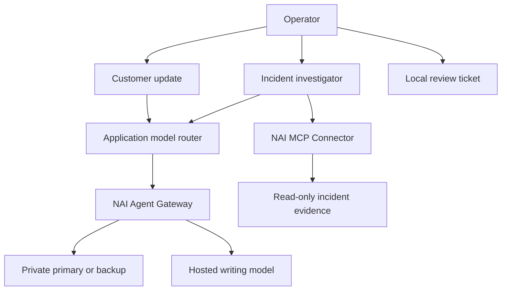

# Checkout incident | Systems Engineering workshop

**Start on a laptop** with Python 3.9+ and a modern browser. From the repository root run `python3 v2/server.py`. The browser opens on http://127.0.0.1:8765. Rehearsal runs offline, with deterministic model decisions and local tool fixtures. This is a single-presenter session with temporary in-memory state. Replay starts a new case.

## First meeting · three minutes

Ask “Who owns the customer communication when checkout starts failing?” Click **Investigate incident**. Explain the evidence and the proposed next step. Click **Draft customer update** and expand **What the writing model received**. Ask “Which of your incident fields could cross that boundary?” Click **Open rollback review** to record the operator decision. The ticket is local and simulated. No change is executed. Stop here for a business audience.

## Second meeting · twelve minutes

| Audience | Presenter action | Evidence / discovery |
|---|---|---|
| Service owner | Read the finding, approve a review | Did impact and timing justify involving the owner? What further evidence would they require? |
| Application lead | Expand Execution trace | Each model decision is followed by an allowlisted tool result. Which tools should their agent be able to call? |
| Security | Inspect the exact hosted input; inspect the NAI connector tool scope and access log in the lab | The application restricts outbound content. The connector controls which tools its key can access. Who owns each policy? |
| SRE | Replay with model failure | The first private call times out before dispatch. The app router retries a private backup; later calls resume normally. Compare route with returned model. |
| AI platform | Compare prefix reuse | Local causal attention recomputes one position with a warm prefix. In live mode inspect returned cached prompt tokens in the trace, where available. |
| Infrastructure / FinOps | Open the private endpoint and deployment in NAI, then its cluster in NKP | Establish workload placement, GPU capacity, usage, and responsibility for serving. Agree a workload and a measurement window for a PoC. |

**Why do anything?** Quantify time spent assembling evidence during the last real outage. **Why now?** Ask about the next release peak or policy deadline. **Why Nutanix?** Show one internal investigation spanning application policy, NAI private inference, a governed connector and hosted model access. Ask the customer to choose the boundary they need to prove.

## Live lab setup

Use an isolated NAI tenant with synthetic data. Install `python3 -m pip install -r v2/requirements-live.txt` in a virtual environment. Run `python3 v2/tools_server.py` on a host reachable from the NAI connector (default MCP path /mcp, port 8000). Register the server and expose only the three read tools. Restrict reachability to the connector. Give the presenter's key access to those tools. Configure three Chat Completions routes in Agent Gateway. Pin both private routes, including any gateway-side fallback, exclusively to private backends. The hosted route receives only the fixed public bulletin. Verify route membership in NAI before using live mode.

| Environment variable | Value |
|---|---|
| DEMO_MODE | live |
| PRIVATE_GATEWAY_URL, PRIVATE_BACKUP_GATEWAY_URL, HOSTED_GATEWAY_URL | Complete HTTPS Chat Completions URLs for each gateway route |
| PRIVATE_MODEL, PRIVATE_BACKUP_MODEL, HOSTED_MODEL | Configured model aliases on those routes |
| GATEWAY_KEY, MCP_KEY | Virtual keys for model access and the MCP connector |
| MCP_CONNECTOR_URL | HTTPS Streamable HTTP connector URL |

Start the same server command. Choose a private model that can return a single JSON object as instructed. Invalid decisions stop the run. The model name in the UI comes from the response, which can be an alias. Confirm actual backend identity against gateway logs. The trace includes each model call, selected route, retries, tool names and optional backend usage. Unreported cached tokens are unknown. A gateway alias and an app-injected fault cannot verify native gateway failover. Use the original fault lab for upstream failure validation.

## Architecture and data flow

The investigator receives a goal, the allowed tools and evidence obtained so far. It selects one unvisited tool per iteration. The orchestrator validates each choice, calls MCP, returns the result to the planner and stops after three reads and one synthesis. Only the operator can create a local review record. The communications task receives a fixed, public-safe incident bulletin; it cannot invoke tools or access the private transcript. This deliberately narrow disclosure policy is suited to the single checkout scenario.

**Platform walk-through.** Start with where the retail service operates on Nutanix Cloud Platform. Show the Kubernetes cluster and GPU workers supporting NAI in the lab. Open the private inference endpoint, its selected model and serving configuration. Follow a private request and a hosted request in Agent Gateway, then a tool request in the MCP connector. End with who owns monitoring, placement and capacity. GPU allocation, replica placement, fine-tuning, storage and native cache-aware routing are platform discussion points; this app does not configure them.

**KV cache.** During causal attention a decoder can reuse keys and values for previously processed positions. The local exercise computes identical outputs with and without prefix reuse on one small attention head. It is a teaching example independent of inference telemetry. For a platform exercise, repeat the same investigation with matching prefix, model and replica. Inspect cached-token counters if exposed, or model-server metrics. Warm latency alone cannot establish a cache hit.

## Review of v1 and presenter preparation

Reviewed main at fb54309, including README_SE.md, the FastAPI handlers, MCP client, gateway client and web portal. The original scenario uses keyword tool selection, a predefined operations sequence, and separate portal, operations and control views. V2 keeps the guided stakeholder narrative, real versus rehearsal distinction and separate model/tool access. A single case replaces portal navigation, persona tabs, duplicate prompt shortcuts and setup controls. Presenter tools hold the optional experiments.

Before a workshop, rehearse the three-click story, verify each private backend and each MCP permission with the lab owner, then test the hosted draft. Capture one next step: a customer workflow, its data boundary, the business owner and a success measure. For the SE role play, ask the observer to record whether the SE discovered each of those four items.
